# Architecture and data flow

## Implemented topology

The source implements a browser/API frontend plus a backend service. PostgreSQL with pgvector stores tenants, users, CRM connections, leads, call state, call jobs, calls, transcripts, events, analyses, and integration configuration. Redis supports application events, locks/rate limits, and Celery. Celery workers execute CRM reconciliation, due-call dispatch, call execution, and callbacks. The telephony path is Plivo REST → SIP trunk → Asterisk/PJSIP → ARI `Stasis` handler → mixing bridge + externalMedia/RTP → Python voice worker → STT/LLM/TTS → RTP back to Asterisk.

The local Compose API lifespan deliberately does not create a second ARI event listener; `apps/api/app/voice_pipeline/worker.py` is the intended ARI event consumer. Current local Compose status did not show that optional voice-worker running.

## Lead-to-call flow

1. An administrator completes Google Sheets OAuth through the CRM API, selects a spreadsheet/range and maps columns, then requests sync. OAuth completion does not itself perform the initial import; the sync API is explicit.
2. `crm_service.run_sync_job` reads provider rows and upserts by tenant/provider/provider lead ID. A newly inserted lead writes a durable pending `lead.created` automation record. Existing unchanged rows should not create new lead-created records.
3. Pending automation is retried; eligibility checks include tenant/call state, suppression/rules, a Redis lead lock, and existing active jobs before writing a call job.
4. Celery Beat schedules CRM reconciliation every 300 seconds, call-job dispatch every 15 seconds, and callback enqueue every 60 seconds. The worker consumes dispatched tasks. These processes are stopped at audit time, so automatic reconciliation/dispatch is not currently active.
5. A call task reaches `call_service.dispatch_call_job`/`initiate_outbound_call`, which invokes the provider selected by configuration. In live Plivo mode this creates a paid external call. This audit did not invoke it.
6. Plivo answer XML routes to `/api/v1/plivo/xml/{call_id}` and describes a SIP URI using `call_<UUID>@SIP_PUBLIC_HOST`. Its signed answer request routes to Asterisk's `from-trunk` context and expected `Stasis(voxai_voice_app,plivo_outbound,<UUID>)` route.
7. The ARI event handler creates the bridge, externalMedia leg, RTP manager session, then a voice session. Incoming RTP is passed to VAD/STT; LLM text is streamed by phrase into TTS; PCM audio is queued for RTP transmission.
8. Hangup handling removes active session/channel/bridge state, finalizes the call, and publishes events. Setup-failure cleanup and correct provider/channel ID separation remain risks.

```mermaid
flowchart LR
  Sheets[Google Sheets] --> Sync[CRM OAuth/config + sync API]
  Sync --> Lead[(PostgreSQL leads)]
  Lead --> Outbox[lead.created outbox/retry]
  Outbox --> Eligibility[eligibility + Redis lock]
  Eligibility --> Jobs[(PostgreSQL call jobs)]
  Beat[Celery Beat] --> Worker[Celery worker]
  Jobs --> Worker
  Worker --> Plivo[Plivo REST originate]
  Plivo --> SIP[Plivo SIP trunk]
  SIP --> Asterisk[Asterisk PJSIP / ARI Stasis]
  Asterisk <--> RTP[externalMedia RTP bridge]
  RTP <--> Voice[voice worker + VAD / STT / LLM / TTS]
  Voice --> RTP
  Asterisk --> Callbacks[Plivo answer/status callbacks]
  Callbacks --> API[FastAPI]
  API --> DB[(PostgreSQL calls/events/transcripts)]
```

## Implemented versus unverified

The diagram represents source-defined integration points, not a validated live call. Prior Oracle evidence showed ARI connectivity but did not establish Plivo origination, loaded outbound route, publicly reachable callbacks, RTP packet flow, two-way audio, or correct hangup correlation. The Windows-host worker/Oracle-host Asterisk topology must not be conflated with the all-in-Docker development topology. The Asterisk RTP port range and the Python UDP listener allocation range are separate settings and need a reachable route between them; equality is not inherently required.
