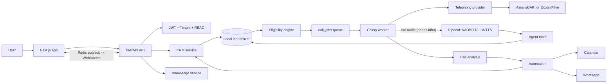

# Architecture

Modular monolith (FastAPI) + Celery workers + Next.js web app. Every layer talks to the next one only: **Router -> Service -> (Repository/SQLAlchemy) -> Database**; external systems are only reached through provider adapters.

* **CRM = source of truth for CRM fields; PostgreSQL = operational truth.** Calls use the local mirror, never a live CRM call.
* **Tenant isolation**: `tenant_id` is only ever taken from the verified JWT (or, for webhooks, from the stored connection). Every query filters on it; vector search is `WHERE tenant_id = ...`; WebSocket channels are `events:<tenant_id>`.
* **Provider abstraction**: `app/providers/{crm,telephony,calendar,whatsapp,voice}`; `*_PROVIDER_MODE=mock` selects the isolated mocks, and `ENV=production` refuses to boot with any mock.
* **Duplicate-call protection (3 layers)**: Redis lock -> `call_jobs (tenant_id, idempotency_key)` unique -> partial unique index "one active job per lead" -> `SELECT ... FOR UPDATE SKIP LOCKED` in `dial_call` -> final eligibility re-check immediately before dialing.
